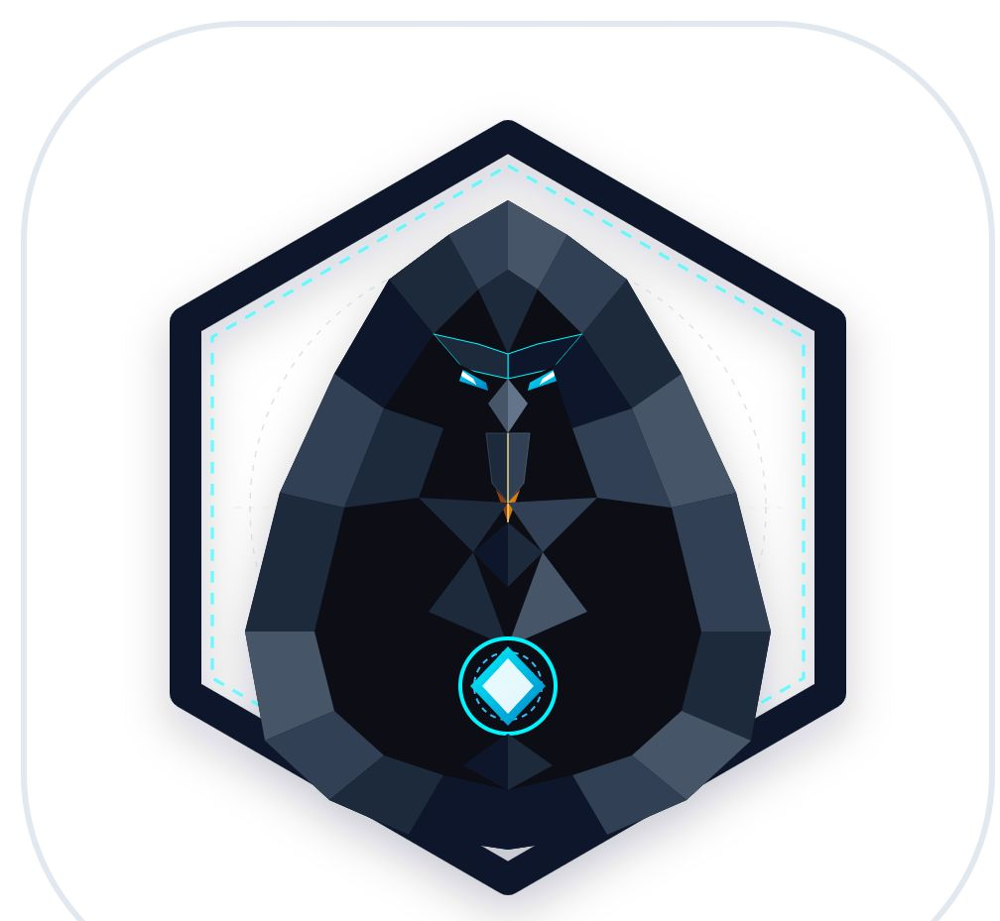
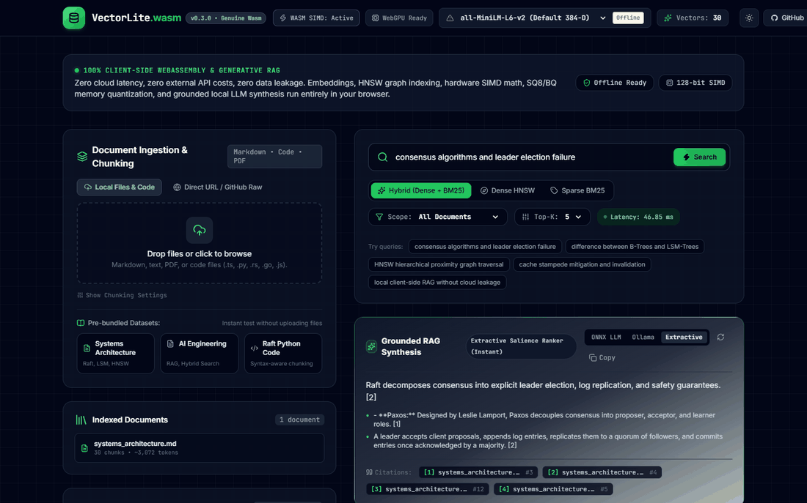
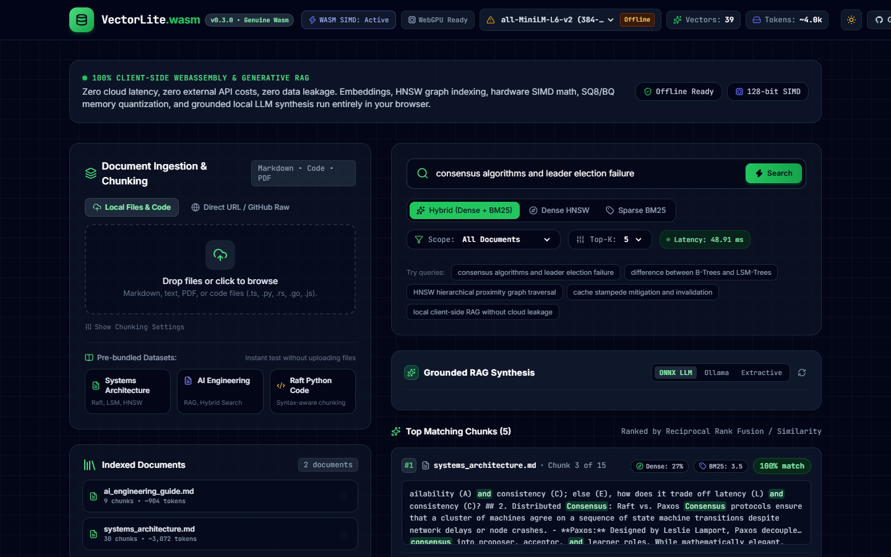
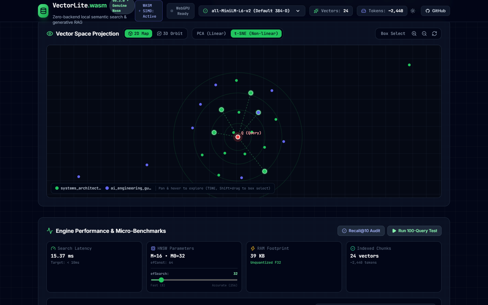
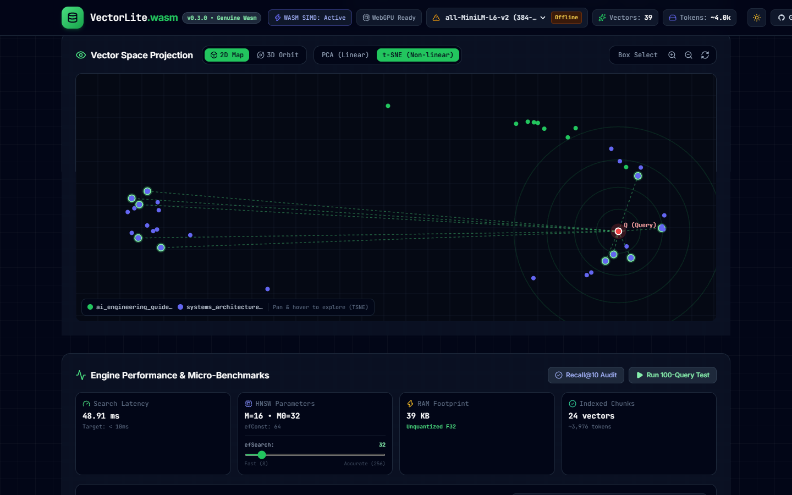

<p align="center">
  <picture>
    <source media="(prefers-color-scheme: dark)" srcset="docs/images/logo.svg">
    
  </picture>
</p>

<h1 align="center">VectorLite-Wasm</h1>

<p align="center">
  <strong>Client-side vector search and semantic retrieval engine running entirely inside the browser via WebAssembly, HNSW, and Web Workers.</strong>
</p>

<p align="center">
  
  
  
  
  
  
  
</p>

---

VectorLite-Wasm is an in-browser vector search engine and semantic document retrieval system. It runs entirely inside the browser through WebAssembly and Web Workers, executing quantized transformer models (ONNX Runtime Web) alongside an in-memory Hierarchical Navigable Small World (HNSW) index, hardware-accelerated 128-bit WebAssembly SIMD math, WebGPU matrix acceleration, Okapi BM25 lexical search, true runtime vector quantization (SQ8 & 1-bit BQ), and client-side generative grounded RAG with streaming token output.

No document text or vector embeddings are transmitted to external servers.

---

## Interactive Demo

<p align="center">
  
</p>

## Visual Studio & Architecture

### Ingestion, Semantic Search & Local Grounded RAG


### Dual Spatial Projections: 3D Orbit & 2D t-SNE / PCA with Box Selection


### In-Memory Benchmarks, Recall@10 Ground Truth & Quantization Telemetry


---

```
                  +-------------------------------------------------------+
                  |                    Browser Window                     |
                  |                                                       |
Document Drop --->|  [Recursive & Syntax-Aware Code Chunker]              |
                  |  [Document Library & Dynamic Rebuild Manager]         |
                  |          |                                            |
                  |          v (Batch Text / Code Chunks)                 |
                  |  [Embedding Web Worker: ONNX Runtime Web / WebGPU]    |
                  |          |                                            |
                  |          v (384-D Float32 / Quantized SQ8)            |
                  |  +-------------------------------------------------+  |
                  |  |  In-Memory Hybrid Storage                       |  |
                  |  |  - HNSW Index (Dense Cosine Graph)              |  |
                  |  |  - WebAssembly 128-bit SIMD Kernel              |  |
                  |  |  - WebGPU Matrix Kernel with CPU Fallback       |  |
                  |  |  - Runtime SQ8 & BQ Quantization                |  |
                  |  |  - BM25 Index (Sparse Inverted Index)           |  |
                  |  |  - Predicate Metadata Filter Engine             |  |
                  |  |  - Binary (.vlws) & JSON (.vlite) Snapshots     |  |
                  |  |  - IndexedDB Persistence & PWA Cache API        |  |
                  |  +-------------------------------------------------+  |
                  |          |                                            |
User Query ------>|  [Reciprocal Rank Fusion Engine]                      |
                  |          |                                            |
                  |          +---> [RAG Worker: ONNX LLM / Streaming]     |
                  |          |                                            |
                  |          v                                            |
                  |  [Ranked Matches, Dual 2D/3D PCA & t-SNE Radar]       |
                  +-------------------------------------------------------+
```

## Features

- **Zero Network Transmission:** All embedding generation, vector distance calculations, and graph routing occur inside the browser.
- **Hardware WebAssembly 128-bit SIMD:** Dedicated WebAssembly kernel compiled with 128-bit SIMD vector instructions (`v128`) for dot products and Euclidean distances.
- **WebGPU Matrix Acceleration:** Hardware accelerated vector operations on supported devices with automatic fallback to SIMD Web Workers.
- **Hierarchical Navigable Small World (HNSW):** Logarithmic graph-based approximate nearest neighbor search with configurable `M`, `M0`, and `efConstruction`.
- **True In-Memory Vector Quantization:** Real runtime SQ8 (Int8 symmetric scaling for 75% RAM reduction) and 1-bit Binary Quantization (BQ bit-packing for 96.8% RAM reduction via hardware POPCNT).
- **Dual Spatial Projections (PCA & t-SNE):** Interactive 2D/3D visualization using fast power-iteration PCA alongside Barnes-Hut and exact t-SNE manifold projections.
- **Marquee Box Selection:** Select clusters of vectors on canvas to inspect multi-vector centroids and distance distributions.
- **Hybrid Search with Reciprocal Rank Fusion (RRF):** Blends dense semantic embeddings with sparse BM25 term frequency scores to handle conceptual meaning and exact identifiers equally well.
- **Client-Side Generative Grounded RAG:** Integrates an in-browser quantized ONNX sequence-to-sequence LLM (`LaMini-Flan-T5-77M`) with word-by-word streaming generation, local Ollama endpoint support, or instant extractive salience ranking with numbered citations `[1]`, `[2]`.
- **Conversation Threading & Export:** Multi-turn RAG chat history with instant export to structured Markdown and JSON.
- **Recall@10 Verification Engine:** Automated benchmark testing HNSW retrieval accuracy against ground truth brute force linear scans.
- **Document Library Management:** Inspect individual ingested files, chunk counts, token estimations, and delete documents with automatic index recompaction.
- **Configurable Advanced Chunking:** Adjust chunk sizes, overlap tokens, and custom regex separators with immediate preview.
- **Multi-File Batch Drop:** Ingest multiple documents, code files, and PDFs simultaneously with batch progress bars.
- **Dual Snapshot Formats:** Save and restore index state using portable JSON (`.vlite`) or compressed binary snapshots (`.vlws`) that are 4x smaller.
- **PWA Offline Support:** Complete offline capability via Service Worker, Cache API precaching, and offline network state indicators.
- **Dark and Light Theme Toggle:** Persisted accessible color palettes with high-contrast elements.
- **Multi-Model Selector:** Switch between `all-MiniLM-L6-v2` (fast 384-D), `bge-small-en-v1.5` (high-accuracy retrieval), and `multilingual-e5-small` (100+ languages) on the fly.
- **Metadata & Document Scoping Filter:** Scope searches to specific documents or metadata attributes while preserving HNSW logarithmic routing speed.
- **Find Similar (Query-by-Example):** Retrieve nearest neighboring chunks using a stored chunk's vector embedding without generating new query embeddings.
- **Syntax-Aware Code Chunker:** Preserves functions, classes, interfaces, and struct blocks intact for Python, TypeScript, Rust, Go, JavaScript, and JSON.

## Quick Start

### Prerequisites

- Node.js 18 or higher
- npm 9 or higher

### Installation

```bash
git clone https://github.com/alexandrmotologa/vectorlite-wasm.git
cd vectorlite-wasm
npm install
```

### Development Server

```bash
npm run dev
```

Open `http://localhost:5173` in your browser.

### Production Build

```bash
npm run build
npm run preview
```

### Run Automated Tests

```bash
npm test
```

## Architecture & Search Mechanics

### Dense HNSW Index

The engine implements an in-memory multi-layer proximity graph based on the Malkov-Yashunin formulation:

1. Upper layers contain long-range connections for fast greedy routing toward the query neighborhood.
2. Layer 0 contains a dense graph bounded by degree `M0 = 2 * M` for fine-grained nearest neighbor selection.
3. Cosine distances between normalized `Float32Array` vectors are computed using 4-step loop unrolling to optimize CPU cache lines.

### Hybrid Retrieval (RRF)

Dense vector search can miss exact code names or specific variables, while lexical search can miss conceptual synonyms. VectorLite combines both using Reciprocal Rank Fusion:

$$RRF(d) = \sum_{m \in M} \frac{w_m}{k + r_m(d)}$$

Where $k = 60$, $r_m(d)$ is the rank in model $m$, and $w_m$ is the modality weight.

### Vector Quantization

- **Scalar Quantization (SQ8):** Compresses 32-bit floats into signed 8-bit integers (`Int8Array`) using absolute maximum dynamic scaling. Reduces memory from 1,536 bytes to 388 bytes per 384-dimensional vector while maintaining >99% cosine correlation.
- **Binary Quantization (BQ):** Converts dimensions to 1-bit binary representations based on sign ($v_i > 0 \to 1$, $v_i \le 0 \to 0$), packing 384 dimensions into 48 bytes. Computes Hamming distance via bitwise XOR and hardware POPCNT.

### Local Grounded RAG & Streaming Synthesis

Extracts high-salience factual sentences from top retrieved chunks, feeds the grounded prompt into the local ONNX language model, and streams generated tokens directly into the chat interface with numbered citations `[1]`, `[2]`.

## Project Structure

```
vectorlite-wasm/
├── docs/
│   ├── images/              # Architecture diagrams, logos, and screenshots
│   └── API.md               # API documentation for engine modules
├── public/
│   └── samples/             # Pre-bundled technical datasets & code files
├── src/
│   ├── components/          # React UI components (Radar, Search, Dropzone, RAG, Benchmarks)
│   ├── engine/              # Core standalone modules
│   │   ├── binary_snapshot.ts # .vlws compressed binary export/import
│   │   ├── bm25.ts          # Okapi BM25 lexical engine
│   │   ├── chunker.ts       # Recursive markdown text splitter
│   │   ├── code_chunker.ts  # Syntax-aware code chunker
│   │   ├── hnsw_index.ts    # HNSW graph indexing & search
│   │   ├── hybrid.ts        # Reciprocal Rank Fusion combiner
│   │   ├── pca.ts           # Online PCA 2D & 3D cluster projector
│   │   ├── pdf_loader.ts    # Client-side PDF text extractor
│   │   ├── quantization.ts  # SQ8 and BQ vector quantization
│   │   ├── rag_synthesizer.ts # Local grounded RAG answer generator
│   │   ├── recall_eval.ts   # Recall@10 ground-truth evaluation
│   │   ├── similarity.ts    # Unrolled SIMD-friendly vector math
│   │   ├── snapshot.ts      # .vlite JSON snapshot export/import
│   │   ├── storage.ts       # IndexedDB storage layer
│   │   ├── tsne.ts          # Exact & Barnes-Hut 2D t-SNE projection
│   │   ├── wasm_simd.ts     # WebAssembly SIMD loader & bindings
│   │   └── webgpu.ts        # WebGPU hardware acceleration detection
│   ├── workers/             # Web Workers (Embedding ONNX & RAG LLM)
│   ├── App.tsx              # Main application shell
│   └── index.css            # Tailwind & custom glow styles
├── tests/                   # 12 Vitest test suites (36 unit tests)
└── vite.config.ts           # Vite configuration with Wasm & PWA plugins
```

## License

MIT License. Built with ❤️ by Alexandr Motologa.
